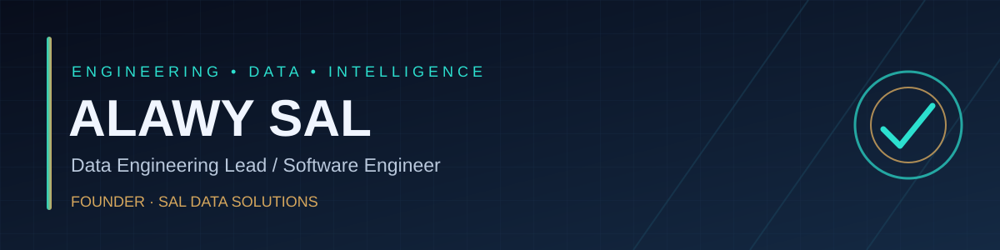

### Building reliable data platforms, useful software, and better decisions.

## 👋 About me

I'm **Alawy Sal**, a **Data Engineering & BI Lead** and **Software Engineer** based in **Bissau, Guinea-Bissau**. I work across the data lifecycle — from ingestion and large-scale processing to analytics, visualization, and business applications.

I'm also the **Founder of [SAL Data Solutions](https://saldatasolutions.com)**, focused on turning complex information into practical, measurable outcomes.

- 🧠 **Focus:** Data Engineering · Business Intelligence · Software Architecture · AI
- 🏗️ **I build:** Data pipelines, analytics platforms, APIs, dashboards, and full-stack applications
- 🤝 **Open to:** Collaboration, consulting opportunities, and impactful technology projects
- 🌍 **Languages:** Portuguese · French · English · Arabic

## ⚡ Core expertise

| Data platforms | Software engineering | Analytics & AI |
| :--- | :--- | :--- |
| ETL / ELT pipelines | Backend APIs & services | KPI design & reporting |
| Big Data processing | Web & mobile applications | BI dashboards |
| Data modeling & quality | System architecture | ML-assisted workflows |
| Orchestration & automation | Integrations & DevOps | Decision support |

## 🛠️ Tech stack

**Languages**  

**Frontend & Mobile**  

**Backend & APIs**  

**Big Data & BI**  

**Databases & Search**  

**Tools & AI**  

## 🚀 Projects & initiatives

> Selected initiatives and project concepts. Public repository links will be added when available.

| Project | What it does | Area |
| :--- | :--- | :--- |
| **SAL BI Platform** | Analytics and dashboard platform for business users | BI · Full Stack |
| **Mediation Bakia Framework** | Modular telecom data collection and processing framework | Data Engineering |
| **Jarvis AI Assistant** | Local-first personal assistant for search, data, and voice workflows | AI · Python |
| **Customer Satisfaction Analytics** | Review ingestion, storage, search, and sentiment analysis | ETL · NLP |
| **AI Language Teacher** | Personalized language learning and course management concept | AI · EdTech |

## 🏢 SAL Data Solutions

> **Transforming Data into Decisions**

I founded **SAL Data Solutions** to help organizations unlock value from data through **Data Engineering, BI & Analytics, AI & Automation, and Software Development**.

**Explore:** [saldatasolutions.com](https://saldatasolutions.com)

## 📈 GitHub activity

GitHub widgets are provided by third-party services and may occasionally be unavailable. Language statistics reflect public repository code, not overall proficiency.

## 🤝 Let's connect

Have a data, BI, AI, or software challenge? Let's talk.

📩 **Email:** [alawysal@gmail.com](mailto:alawysal@gmail.com)  
🌐 **Company:** [saldatasolutions.com](https://saldatasolutions.com)  
💻 **GitHub:** [@Alawysal](https://github.com/Alawysal)

Built with curiosity, engineered for impact.

